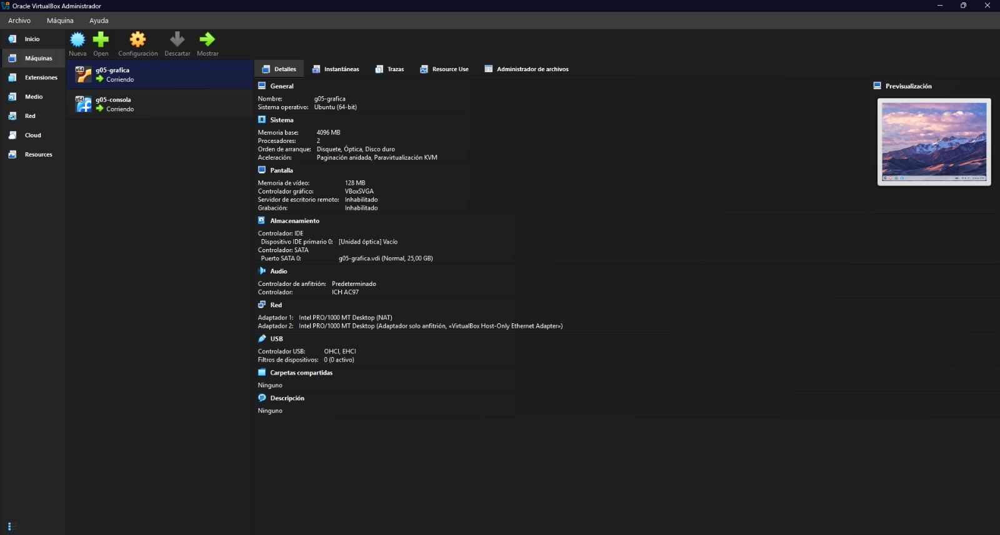

# Sprint 1 · Montaje

**Grupo 5** · VMs: `g05-grafica` (Zorin OS) y `g05-consola` (Fedora Server)

## Video del sprint

<iframe width="560" height="315" src="https://www.youtube.com/embed/ID_DEL_VIDEO"
 title="Sprint 1" frameborder="0" allowfullscreen></iframe>

## 1. VM gráfica (g05-grafica)

Estos son los detalles la VM grafica llamada g05-grafica y a continuación se mostrara la evidencia de todo lo que se realizo con ella


**Qué hicimos:** [instalamos Zorin OS con particionado manual en un disco de 25 GB, con 2 CPU y 4 GB de RAM, 128 MB memoria de video].

| Partición | Tamaño | Por qué ese tamaño |
|---|---|---|
| `/` | [14 GB] | Aloja el sistema operativo, librerías y aplicaciones instaladas con margen para actualizaciones. |
| swap | [2 GB] | Respalda la memoria física en disco para evitar cierres por falta de RAM sin quitar demasiado espacio. |
| `/home` | [9 GB] | Guarda los archivos y configuraciones del usuario aprovechando todo el espacio libre restante del disco. |

**Comandos:**

```
lsblk
df -h
cat /etc/fstab
date
```
En esta imagen mostramos el particionado manual de la maquina grafica (aclaramos que se ve así porque lastimosamente perdimos la imagen que había antes del recuadro emergente) 


En esta imagen mostramos el particionado por medio del comando lsblk


En esta imagen muestra cuánto espacio libre/usado tiene cada partición montada en formato legible (GB/MB) con el comando df -h y  luego se puede apreciar el comando cat /etc/fstab el cual muestra cómo quedan configuradas las particiones para montarse automáticamente al iniciar el sistema.


**Instalación de los navegadores y editores de texto:**

**Comandos:**

```
sudo apt update
sudo apt install -y chromium-browser firefox
sudo apt install -y geany vim nano
sudo dnf install -y make rsync curl git wget
which make rsync curl git wget

```
En la siguiente imagen se puede apreciar el uso del sudo apt update el cual descarga y actualiza la lista local de paquetes disponibles desde los repositorios configurados en el sistema.


En esta se realizo la instalación de los navegadores con el comando sudo apt install -y chromium-browser firefox


Aquí se ven a los 2 navegadores instalados ya abiertos y funcionando 


en la siguiente se instalaron los editores de texto/codigo con sudo apt install -y geany vim nano


Finalizacion de la instalacion de los Verificación de las rutas de los navegadores y editores ejecutando: which brave-browser firefox geany vim nano 


Ahora se pueden apreciar los 3 editores de texto abiertos


**Aqui damos por finalizado el proceso de instalar los mavegadores y los editores de texto/codigo para la maquina g05-grafica**.

## 2. VM consola (g05-consola)

Estos son los detalles la VM de consola llamada g05-consola y a continuación se mostrara la evidencia de todo lo que se realizo con ella


**Qué hicimos:** [instalamos Fedora Server con particionado manual, 25 GB, 2 CPU, 2 GB de RAM, 16 MB memoria de video].

| Partición | Tamaño | Por qué ese tamaño |
|---|---|---|
| `/` | [7 GB] | Supera el mínimo de 5 GB para alojar el sistema operativo base, servicios, configuraciones y herramientas solicitadas con margen libre. |
| swap | [2 GB] | Duplica el mínimo de 1 GB exigido para dar espacio de intercambio y respaldo de memoria ante picos de carga. |
| `/var` | [12 GB] | Supera el mínimo de 10 GB porque aquí Docker y Minikube guardan imágenes, contenedores y volúmenes en /var/lib/docker sin llenar el resto del sistema. |
| `/home` | [3.9 GB] | Supera el mínimo de 1 GB para almacenar archivos de usuario, scripts, códigos y carpetas de trabajo de forma aislada. |
 | `BIOS boot` | [2 MB] | Es una partición pequeña de arranque necesaria cuando el disco usa tabla GPT en modo BIOS/legado para alojar el cargador de arranque. |

**Comandos:**

```
lsblk
df -h
cat /etc/fstab
which make rsync curl git wget
date
Aclaración: se concatenaron los anteriores comandos en una sola linea como se indica mas adelante

comando de instalación de herramientas de consola:
sudo dnf install -y make rsync curl git wget
```
Empezamos con el editor manual de particiones del installardor de fedora server, aquí decidnos el tamaño de cada partición como se indico en la tabla anterior


Se inicia la  instalación de las herramientas de la VM de consola con el comando: sudo dnf install -y make rsync curl git wget


Finalización de la instalación de herramientas y después se ejecuta los comandos concatenados para revisar las particiones y verificar la ruta  : date && lsblk && df -h && cat /etc/fstab && which make rsync curl git wget


**Explicación:** En esta parte se certifico al final con "which make rsync curl git wget" la ruta donde se instalaron las herramientas sin arrojar ningun error .

## 3. Red

**Qué hicimos:** [adaptador 1 en NAT y adaptador 2 en solo anfitrión en las dos VMs].

En estas imágenes se puede validar que están en NAT y solo anfitrión ambas VM

Adaptador de  Red de la VM grafica



Adaptador de  Red de la VM consola


**Comandos:**

```
ip a
ping -c 2 IP_DE_LA_OTRA_VM
date

Aclaración: se uso la concatenacion: date && ip a

```
A continuación se puede visualizar el uso del comando  "date && ip a" el cual arrojo como resultado para la VM grafica: 192.168.56.101. y para la VM  de consola: 192.168.56.102.

En la VM grafica:


En la VM de consola


**Explicación:** En VirtualBox, cada máquina virtual configurada únicamente en NAT queda aislada detrás de su propio espacio de traducción de direcciones de red (NAT) virtual y por eso no se podrían ver mutuamente solo con NAT.

Ahora se muestra la ejecucion del comando "ping -c 2 IP_DE_LA_OTRA_VM" en ambas MVS

En la VM grafica:


En la VM de consola


**Explicación:** El comando ping -c 2 IP_DE_LA_OTRA_VM sirve para comprobar si la otra máquina virtual (g05-grafica o g05-consola) responde en la red enviando exactamente 2 paquetes de prueba y deteniéndose automáticamente.

## 4. SSH

**Qué hicimos:** Con el comando de ssh conectamos la VM grafica con la VM de consola como se podrá apreciar a continuación.

```
hostname && whoami && date
ssh usuario@IP_DE_LA_CONSOLA
sudo poweroff
date
echo "NN05-3GSN" > ~/codigo_sprint1.txt && cat ~/codigo_sprint1.txt && date
cat ~/codigo_sprint1.txt && date

```
Ejecutamos el comando ssh pablo@192.168.56.102


**Explicación:** es el comando que permite abrir una terminal remota en otra máquina a través de la red mediante una conexión cifrada (SSH significa Secure Shell).
ssh: El programa cliente que inicia la conexión segura hacia el servidor remoto.

usuario: El nombre de la cuenta con el que iniciare sesión en la máquina de destino (pablo)

@: Separador que indica «en» (conectar tal usuario en tal dirección).

IP_DE_LA_CONSOLA: La dirección IP de la máquina a la que te conectas (en tu proyecto, la IP del adaptador solo-anfitrión de g05-consola, que es 192.168.56.102).


Se ejecuto el comando hostname && whoami && date al ya haber conectado y iniciado sesión en la terminal de la VM de consola a traves de la terminal de la VM grafica 


**Explicación:** hostname: Imprime el nombre del equipo donde se está ejecutando el comando y demuestra que no esta en la terminal locar de g05-grafica.

whoami: Muestra el usuario activo en esa sesión (pablo)

date: Imprime la fecha y hora del sistema


Ahora se crea el archivo para el código que nos fue asignado con el comando: echo "NN05-3GSN" > ~/codigo_sprint1.txt && cat ~/codigo_sprint1.txt && date y luego cat ~/codigo_sprint1.txt && date


Antes del final ejecutamos el comando sudo poweroff para cerrcar la conexion entre ambas maquinas y volver a la terminar de la propia VM grafica


Finalmente ejecutamos sudo poweroff en la VM grafica para apagarla y cerrarla, a continuación se muestra el después de ejecutar el comando  


## 5. Instantáneas

**Qué hicimos:** [una instantánea llamada `instalacion-limpia` por VM, con la VM apagada].


**Explicación:** [para qué sirve una instantánea].

## Código del sprint


## Errores y soluciones

| Error | Causa | Solución |
|---|---|---|
| [ej: pantalla negra en Zorin] | [controlador gráfico] | [cambiamos a VBoxSVGA] |
